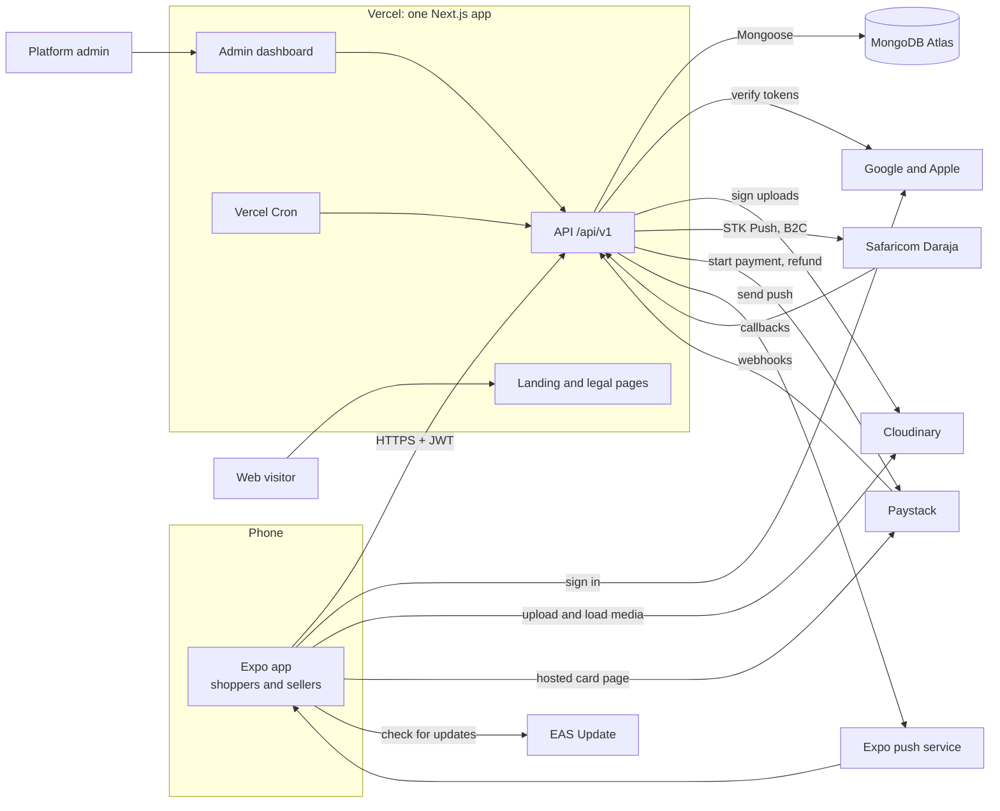
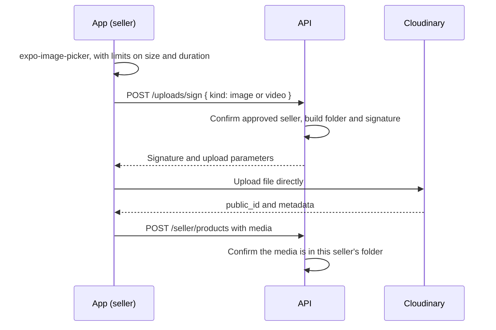
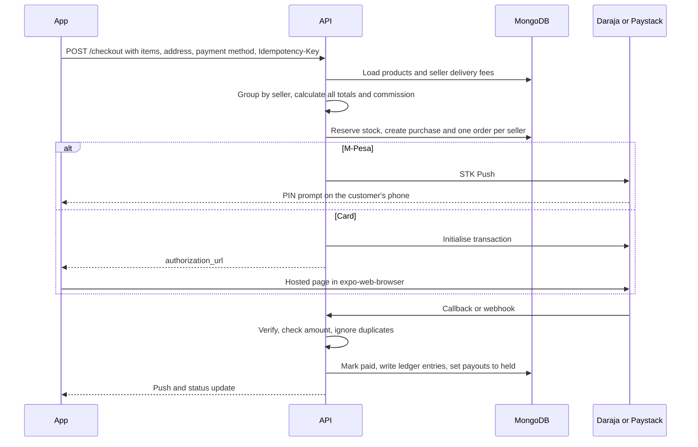
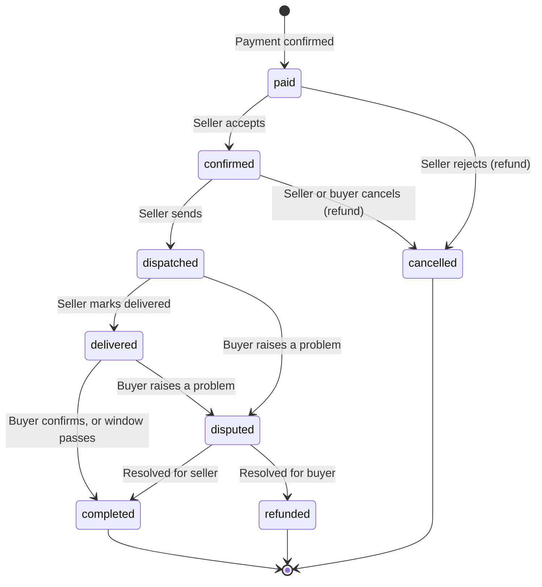

# Architecture

This describes the target system. [Current state](#current-state) lists what exists today, and the [roadmap](ROADMAP.md) gets from one to the other. Reasons and statuses are in the [decision log](DECISIONS.md). Items that are only recommended there are marked *(recommended)* here.

## System overview



| Part | Technology | Location |
| --- | --- | --- |
| Mobile app | Expo SDK 58, React Native 0.88, Expo Router, TypeScript | `HauteCorner/` |
| API, website, admin dashboard | Next.js 16 App Router, TypeScript, Mongoose 9 | `web/` |
| Database | MongoDB Atlas | Hosted |
| Images and video | Cloudinary | Hosted |
| M-Pesa | Safaricom Daraja | Hosted |
| Cards | Paystack | Hosted |
| Native builds, OTA updates | EAS Build, EAS Update | Hosted |

## Repository layout

```text
.
├── HauteCorner/   Expo mobile app
├── web/           Next.js API, website and admin dashboard
├── docs/          Project documentation
├── CLAUDE.md      Working notes for coding agents
└── readme.MD      Project entry point
```

## Mobile app

### Structure *(recommended)*

Existing folders stay, and new code is organised by feature so that screens stay thin.

```text
HauteCorner/
├── app/                 Routes only (Expo Router)
│   ├── (tabs)/          Native tabs, each nesting a native Stack: (home), categories, add-product, saved-items, profile
│   ├── products/[id]    Product details, pushed over the tabs on the root Stack
│   ├── shopping-cart    Cart, also on the root Stack, as are checkout, orders and disputes later
│   └── (seller)/        Seller application, listings, seller orders, earnings (Phase 4)
├── features/
│   ├── auth/            Google and Apple sign-in, session store
│   ├── products/        Query hooks, product UI, video player
│   ├── cart/            Zustand store, grouping by seller
│   ├── checkout/        Delivery details, M-Pesa and card payment
│   ├── orders/          Order history, status timeline, confirm delivery
│   ├── disputes/
│   ├── seller/          Application, listing editor, media upload, earnings
│   ├── wishlist/
│   └── notifications/   Permission, token registration, handlers
├── components/          Shared UI with no business logic
├── plugins/             Local config plugins
├── lib/
│   ├── api-client.ts    fetch wrapper: base URL, auth header, token refresh, errors
│   ├── media.ts         Cloudinary URL helpers
│   └── storage.ts       MMKV instance
├── constants/
└── hooks/
```

### State

| Kind of state | Where it lives | Examples |
| --- | --- | --- |
| Server data | TanStack Query | Products, orders, earnings, wish list |
| Local data that survives restarts | Zustand with MMKV | Cart, preferences |
| Secrets | `expo-secure-store` | Refresh and access tokens |
| Screen state | React state | Form inputs, selected option |

### Conventions

- **Native components come first** ([ADR-032](DECISIONS.md#adr-032-native-components-first)). Use Expo UI and native navigation before writing a custom component. Product cards and the grid are custom only because no native equivalent exists.
- Remote images use `expo-image`, requested through `lib/media.ts`, never React Native's `Image`.
- User feedback uses `react-native-toast-message`.
- Configuration comes from `EXPO_PUBLIC_*` variables, which are compiled into the app and must never hold secrets.
- On iOS 26+, content draws under transparent headers. Screens with a scrolling list set `contentInsetAdjustmentBehavior="automatic"` and keep the Liquid Glass header. Screens without one use `headerTransparent: false`.

## Server

### Structure *(recommended)*

```text
web/
├── app/
│   ├── (site)/        Landing, privacy, terms, seller terms, support, delete-account
│   ├── admin/         Dashboard: sellers, listings, disputes, payouts
│   └── api/v1/        Route Handlers, one folder per resource
├── lib/
│   ├── db.ts          Cached Mongoose connection
│   ├── auth.ts        Token verification, requireUser, requireSeller, requireAdmin
│   ├── http.ts        Response envelope and error handling
│   ├── ledger.ts      The only code allowed to write ledger entries
│   ├── daraja.ts      STK Push, B2C, status queries
│   ├── paystack.ts    Initialise payments, verify, refund
│   ├── cloudinary.ts  Upload signing
│   └── push.ts        Expo push sending and receipts
├── models/            Mongoose schemas
└── schemas/           Zod request schemas
```

### Rules

- Route handlers stay thin: authenticate, validate, call a function, return the response.
- Authorisation happens in each handler. Next.js [advises against relying on proxy alone](https://nextjs.org/docs/app/api-reference/file-conventions/proxy) for this.
- A seller may only read or change their own products, orders and earnings. Test this for every seller route.
- Everything uses the Node.js runtime, because [Mongoose does not support Edge](https://mongoosejs.com/docs/nextjs.html).
- Handlers call `dbConnect()` first. Calling it when already connected does nothing.
- Models are exported as `mongoose.models.X || mongoose.model('X', schema)` to survive hot reload.
- Sorted queries must use an index, because Atlas Free has a 32 MB in-memory sort limit and cannot spill to disk.

### Database connection

```ts
// web/lib/db.ts (outline)
import mongoose from 'mongoose';

export async function dbConnect() {
  if (mongoose.connection.readyState === 1) return mongoose;
  return mongoose.connect(process.env.MONGODB_URI!, {
    bufferCommands: false,
    minPoolSize: 1,
    maxPoolSize: 10,
    maxIdleTimeMS: 5000,
  });
}
```

This follows Vercel's [pooling guidance](https://vercel.com/kb/guide/connection-pooling-with-functions): a pool in global scope, a minimum size of 1, a maximum above 1, a short idle timeout, and `attachDatabasePool` from `@vercel/functions`, which lists MongoDB among its supported pools.

Measured on production in November 2026: 700 health checks at 30 concurrent all succeeded, with connections peaking at 92 of the free tier's 500. Connection counts come from `atlas metrics processes`, because `serverStatus` is blocked on the free tier.

**API routes must stay at request time.** With Cache Components on, a handler that finishes without touching the request can be prerendered during the build, which would freeze even an error response. The `route()` wrapper in `lib/http.ts` reads the request first to prevent this. `next build` should list every API route as `ƒ`.

## Key flows

### Sign-in

```mermaid
sequenceDiagram
    participant App
    participant Provider as Google or Apple
    participant API
    participant DB as MongoDB
    App->>Provider: Native sign-in
    Provider-->>App: ID token
    App->>API: POST /auth/google { idToken }
    API->>API: Verify signature and audience
    API->>DB: Upsert user, create session (hashed refresh token)
    API-->>App: accessToken, refreshToken, user
    App->>App: Save tokens in secure store
    Note over App,API: When the access token expires
    App->>API: POST /auth/refresh { refreshToken }
    API->>DB: Rotate session; reuse of an old token revokes it
    API-->>App: New token pair
```

Google tokens are verified with `google-auth-library`, with the web client ID as the audience. Apple tokens are verified against Apple's public keys with `jose`, with the bundle ID as the audience. Apple sends the user's name only on first sign-in, so save it then.

### Becoming a seller

1. A signed-in user submits an application: business details, payout M-Pesa number, and any identity documents required.
2. Documents go to Cloudinary as private assets *(recommended)*, viewable only through short-lived signed URLs from the admin dashboard.
3. An admin approves or rejects. Approval changes the seller's status and sends a push.
4. Seller screens appear in the app, and the seller can create listings.
5. Changing a payout number returns the seller to review *(recommended)*, since this is a common fraud route.

### Media upload and delivery



The signature is created on the server and [is valid for one hour](https://cloudinary.com/documentation/upload_images). The API secret never leaves the server. Files over 100 MB need chunked uploads, which the video limits are expected to rule out.

**Images:** Request only the size needed, following [Cloudinary's optimization guidance](https://cloudinary.com/documentation/image_optimization).

```text
Grid:    /image/upload/c_scale,w_400/q_auto/f_auto/<public_id>
Details: /image/upload/c_scale,w_1080/q_auto/f_auto/<public_id>
Preview: /image/upload/c_scale,w_50/q_auto:low/f_auto/<public_id>
```

`expo-image` shows the tiny preview as a placeholder and fades in the full image.

**Video:** Delivered with [automatic adaptive streaming](https://cloudinary.com/documentation/adaptive_bitrate_streaming), which adjusts quality to the connection.

```text
/video/upload/sp_auto/<public_id>.m3u8
```

Processing happens on first request, and Cloudinary recommends preparing renditions in advance for production, so request `sp_auto` as an eager transformation at upload *(recommended)*. Using `maxres` to cap resolution (for example `sp_auto:maxres_720p`) reduces credit use.

[`expo-video`](https://docs.expo.dev/versions/latest/sdk/video/) notes that affect this design:

- Use a URL ending in `.m3u8`, or set `contentType: 'hls'`, so that iOS detects the tracks.
- There is no poster prop. Show an `expo-image` poster and hide it on `onFirstFrameRender`.
- HLS does not cache on iOS, so avoid autoplaying video in lists, where it would waste the customer's data and Cloudinary credits. Play on the product page only.
- On Android, one player cannot drive several `VideoView`s at once.

### Checkout and payment



- The client sends only product IDs, options and quantities. Prices, fees and commission come from the server.
- Reaching the Paystack callback URL [does not confirm payment](https://paystack.com/docs/payments/accept-payments/). Only a verified webhook or verify call does, and the amount must match.
- Paystack webhooks are verified with [an HMAC SHA512 of the raw body](https://paystack.com/docs/payments/webhooks/) in `x-paystack-signature`, and acknowledged quickly with a 200. Read the raw body with `request.text()` before parsing.
- Daraja's callback format and security are to be confirmed against Safaricom's documentation in Phase 5. Treat callbacks as untrusted until confirmed with a status query *(recommended)*.
- Unpaid reservations expire, and a scheduled job reconciles payments whose callbacks never arrive.

### Order, delivery and release of funds



| Order state | Seller's money |
| --- | --- |
| `paid`, `confirmed`, `dispatched`, `delivered` | Held |
| `disputed` | Frozen |
| `completed` | Released to the seller's balance, less commission |
| `cancelled`, `refunded` | Returned to the buyer |

**This flow is subject to the [legal review](DECISIONS.md#open-items).**

### Money and the ledger *(recommended)*

Every movement of money creates an immutable ledger entry through `lib/ledger.ts`. Nothing edits or deletes one; corrections are new entries. Balances are calculated from the entries.

| Event | Ledger effect |
| --- | --- |
| Payment received | Buyer's payment is recorded against each seller order |
| Order completed | Seller's balance is credited, and commission is recorded |
| Payout sent | Seller's balance is debited |
| Payout failed | Debit is reversed |
| Refund | Payment is reversed, with the amount traced to the order |

Payouts run as a job, with idempotency keys so that a retry cannot pay twice. Daraja B2C [needs an initiator, an encrypted security credential and result URLs](https://mctaba.com/learn/mpesa/b2c-payouts-tutorial), according to third-party guides. Confirm the details with Safaricom. Card-funded money settles through Paystack rather than M-Pesa, which is [an open question](DECISIONS.md#open-items).

### Disputes

1. The buyer opens a dispute within the window, with a reason and photos. The payout freezes and the seller is notified.
2. The seller can accept a refund or respond. An accepted refund resolves it.
3. If unresolved after a set time, or if either side escalates, it goes to the admin dashboard.
4. An admin decides, and the decision moves the money through the ledger.

### Push notifications

1. After sign-in, the app creates the Android notification channel, asks for permission and calls `getExpoPushTokenAsync({ projectId })`.
2. The app registers the token with the API.
3. The API sends through `expo-server-sdk` when an order, dispute, seller application or payout changes.
4. A scheduled job checks delivery receipts and removes tokens reported as `DeviceNotRegistered`.

On SDK 58, foreground notifications show by default unless a `setNotificationHandler` says otherwise.

### Over-the-air updates

JavaScript and asset changes are published with `eas update` to a channel. A build downloads an update only if its fingerprint matches. See [Deployment](DEPLOYMENT.md#over-the-air-updates).

## Scheduled jobs

| Job | Purpose | On Hobby (daily) | On Pro |
| --- | --- | --- | --- |
| Expire reservations | Return stock from unpaid checkouts | Too slow for real use; run by hand when testing | Every few minutes |
| Reconcile payments | Check payments with no callback | Run by hand when testing | Every few minutes |
| Release funds | Complete orders past the buyer's window | Daily | Hourly |
| Send payouts | Pay released balances, retry failures | Daily | Hourly or daily |
| Push receipts | Remove dead tokens | Daily | Daily |

Jobs require `Authorization: Bearer <CRON_SECRET>`.

## Platform limits that shape the design

These figures were checked against each vendor's documentation in October 2026. Check again before relying on them.

| Service | Limit | What it means for the design |
| --- | --- | --- |
| Vercel Hobby | Non-commercial use only | Move to Pro before launch ([ADR-005](DECISIONS.md#adr-005-real-store-hobby-while-building-pro-before-launch)) |
| Vercel Functions | 4.5 MB request and response body | Media uploads go directly to Cloudinary; lists paginate |
| Vercel Hobby | 1M invocations, 4 active CPU hours, 360 GB-hours of memory per month. Going over can disable a feature for up to 30 days | Cache public product responses; do not poll |
| Vercel Hobby | 100 GB data transfer and 10 GB origin transfer per month | Media never passes through functions |
| Vercel Hobby | Cron at most once a day, within ±59 minutes | See [Scheduled jobs](#scheduled-jobs) |
| Vercel Hobby | Runtime logs kept for 1 hour | Add error reporting before launch |
| Vercel Hobby | Preview deployments can sit behind Vercel Authentication | That would block Safaricom and Paystack callbacks, so test against a stable URL with a protection exception |
| Atlas Free | 0.5 GB including indexes | No files in documents; keep indexes deliberate |
| Atlas Free | 100 operations per second; 10 GB in and out per rolling 7 days; 500 connections | Cache reads; keep pools small. Requests over the limit are throttled |
| Atlas Free | Paused after 30 days with zero connections | Resume by hand after a long gap in development |
| Atlas Free | Daily snapshots, up to 4 kept; no point-in-time restore listed | Review for a financial ledger before launch ([open item](DECISIONS.md#open-items)) |
| EAS Free | 15 Android and 15 iOS builds in the allowance; low-priority queue | Build locally for routine work |
| EAS Update Free | 1,000 monthly active users | Enough to launch; upgrade with growth |
| Cloudinary Free | 25 credits a month across storage, bandwidth and transformations | Compress before upload, request the right size, cap video resolution |

## Environments

| Environment | Mobile build | API | Database | Payments | OTA channel |
| --- | --- | --- | --- | --- | --- |
| Local | Development build | `http://<computer-ip>:3000` | Dev | Sandbox and test keys | `development` |
| Preview | EAS `preview` build | Vercel preview or staging URL | Dev | Sandbox and test keys | `preview` |
| Production | EAS `production` build | Vercel production | Production | Live keys | `production` |

Use separate databases and users for dev and production. Each Atlas project allows only one free cluster, so they share one for now.

## Testing and quality *(recommended)*

| Layer | Tools | Scope |
| --- | --- | --- |
| Mobile checks | `tsc --noEmit`, `expo lint`, `expo-doctor` | Every pull request |
| Mobile unit tests | `jest-expo`, React Native Testing Library | Cart grouping, API client refresh |
| API tests | Vitest, `mongodb-memory-server` | Every route: validation, permissions, pricing, ledger |
| Web checks | `next build`, ESLint, `tsc` | Every pull request |
| Release check | Android release build with R8, on a device or emulator | Before each store release |
| Manual | The [release checklist](DEPLOYMENT.md#release-checklist) | Before each store release |

Permissions, pricing, the ledger and payouts must have tests, because mistakes there lose real money.

## Current state

- **Mobile:** Home, Categories and product details are rebuilt on the new API with native components. The cart, order tracking, Add Product and Wish List screens are still the old ones, restyled, until their phases.
- **Server:** The API has health, config, products and sellers routes, connected to Atlas. The website and draft legal pages are live. The production catalogue is empty, while the dev database holds sample data.
- **Details:** [Known issues](KNOWN_ISSUES.md) lists the defects to fix along the way.
