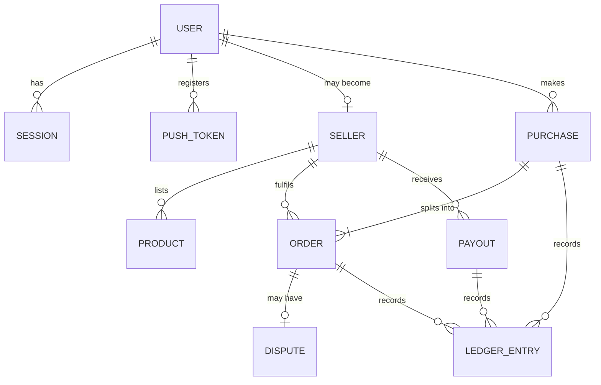

# Data model

The target MongoDB schema, written as TypeScript shapes for the Mongoose models in `web/models/`. All documents get `_id`, and `createdAt` and `updatedAt` through `{ timestamps: true }`.

Approved in [ADR-023](DECISIONS.md#adr-023-technical-foundations-for-phases-1-and-2).



## Principles

- **Do not store files in MongoDB.** Images, videos and documents live in Cloudinary. The free cluster's 0.5 GB limit includes indexes.
- **Embed what is read together.** Order items and addresses are embedded. Sessions and tokens get their own collections because they expire independently.
- **Orders are snapshots.** An order copies title, price, image and commission rate at purchase time, so later edits do not change history.
- **The ledger is append-only.** Entries are never edited or deleted. Corrections are new entries.
- **Every sort uses an index.** Atlas Free has a 32 MB in-memory sort limit and cannot spill to disk.
- **Amounts are integers in KES.**

## User

```ts
type User = {
  email?: string;            // Always verified: by Google or Apple, or by an emailed code. May be an Apple relay address
  passwordHash?: string;     // scrypt, once the user sets a password for email sign-in
  identities: Identity[];    // Linked Google and Apple accounts
  name?: string;
  avatarUrl?: string;
  phone?: string;
  deliveryAddress?: Address;
  role: 'customer' | 'admin'; // Being a seller is a Seller document, not a role
  wishlist: ObjectId[];      // Product IDs, newest first; capped at 200
  deletedAt?: Date;
};

type Identity = {
  provider: 'google' | 'apple';
  providerId: string;        // The token's stable `sub` claim
};

type Address = {
  line1: string;
  area?: string;
  city: string;
  notes?: string;
};
```

| Index | Purpose |
| --- | --- |
| `{ 'identities.provider': 1, 'identities.providerId': 1 }`, unique where present | Find the user at Google or Apple sign-in |
| `{ email: 1 }`, unique where present | One account per verified address, and email sign-in |

Accounts with the same verified email are one account ([ADR-037](DECISIONS.md#adr-037-one-account-per-verified-email)). `scripts/migrate-user-identities.ts` moved the earlier `provider` and `providerId` fields into `identities`.

**Deleted accounts** *(recommended, R-18)* keep only `_id`, `role`, an empty `identities`, `deletedAt` and timestamps, so orders can still refer to them. With the email and identities gone, signing in again with the same Google, Apple or email account creates a new, empty account.

`phone` is stored as `+254` followed by nine digits *(recommended, R-19)*.

## Session

```ts
type Session = {
  userId: ObjectId;
  tokenHash: string;     // SHA-256 of the current refresh token; the raw token is never stored
  previousTokenHash?: string; // Detects reuse of a rotated token
  expiresAt: Date;       // 30 days after the last rotation
  revokedAt?: Date;
};
```

| Index | Purpose |
| --- | --- |
| `{ tokenHash: 1 }`, unique | Look up on refresh |
| `{ previousTokenHash: 1 }`, sparse | Detect reuse |
| `{ userId: 1 }` | Revoke all sessions on account deletion |
| `{ expiresAt: 1 }`, TTL with `expireAfterSeconds: 0` | Remove expired sessions automatically |

Signing out or detected reuse sets `revokedAt`, and the session stays until it expires. Deleting the account removes all its sessions at once.

## EmailCode

A code emailed to confirm an address at sign-up, or to reset a password. A pending sign-up keeps its name and password hash here, so no account exists until the address is confirmed.

```ts
type EmailCode = {
  email: string;
  purpose: 'signup' | 'reset';
  codeHash: string;          // HMAC-SHA256 with a server secret; the code is never stored
  codeExpiresAt: Date;       // 10 minutes after sending
  attempts: number;          // Up to 5
  sentAt: Date;              // A new code may be sent a minute later
  name?: string;             // Sign-up only
  passwordHash?: string;     // Sign-up only
  expiresAt: Date;           // The record goes after a day
};
```

| Index | Purpose |
| --- | --- |
| `{ email: 1, purpose: 1 }`, unique | One live code per address and purpose |
| `{ expiresAt: 1 }`, TTL | Remove old records automatically |

## RateLimit

A request counter for one key in one fixed window ([ADR-039](DECISIONS.md#adr-039-rate-limiting-with-counters-in-mongodb)).

```ts
type RateLimit = {
  _id: string;               // bucket:hash of the key:window start. Email addresses are hashed
  count: number;
  expiresAt: Date;           // The end of the window
};
```

| Index | Purpose |
| --- | --- |
| `{ expiresAt: 1 }`, TTL | Remove finished windows automatically |

## PushToken

```ts
type PushToken = {
  userId: ObjectId;
  token: string;
  platform: 'ios' | 'android';
  lastSeenAt: Date;
};
```

| Index | Purpose |
| --- | --- |
| `{ token: 1 }`, unique | Upsert on register; a token moves to the latest signed-in user |
| `{ userId: 1 }` | Send to all of a user's devices |

## Seller

```ts
type Seller = {
  userId: ObjectId;
  status: 'applied' | 'approved' | 'rejected' | 'suspended';
  businessName: string;
  phone: string;
  payoutMpesaNumber: string;
  payoutNumberChangedAt?: Date; // Payouts pause until an admin reviews a change
  deliveryFee: number;
  deliveryAreas: string;
  returnsNote?: string;
  documents: { kind: string; publicId: string }[]; // Private Cloudinary assets
  review?: { by: ObjectId; at: Date; reason?: string };
};
```

| Index | Purpose |
| --- | --- |
| `{ userId: 1 }`, unique | One seller profile per user |
| `{ status: 1, _id: -1 }` | Admin review queue |

## Product

```ts
type Product = {
  sellerId: ObjectId;
  title: string;
  description: string;
  type: 'shoes' | 'clothing';
  audience: 'men' | 'women' | 'children' | 'unisex';
  price: number;           // Integer KES, at least 1
  media: Media[];          // At least one image; limits on video come from settings
  options: string[];       // Sizes or variants
  stock: number;           // Integer, at least 0
  status: 'active' | 'archived' | 'removed' | 'hidden';
  removedReason?: string;
};

// 'removed' is set by an admin. 'hidden' covers products whose seller is not
// currently approved, so public queries only need to filter on 'active'. It is
// restored to 'active' when the seller is approved again.
type Media = {
  kind: 'image' | 'video';
  publicId: string;
  width?: number;
  height?: number;
  durationSeconds?: number; // Video only
};
```

| Index | Purpose |
| --- | --- |
| `{ status: 1, _id: -1 }` | Default listing, newest first |
| `{ status: 1, type: 1, _id: -1 }` | Filter by type |
| `{ status: 1, audience: 1, _id: -1 }` | Filter by audience |
| `{ status: 1, type: 1, audience: 1, _id: -1 }` | Filter by both |
| `{ sellerId: 1, status: 1, _id: -1 }` | Seller's listings, and the public seller page |
| `{ title: 'text', description: 'text' }` | Search |

Stock is tracked per product, not per size, for now. Per-size stock would need `options` to become objects. Fashion sells out by size, so reconsider before the catalogue grows.

## Purchase

One customer payment, covering one or more seller orders.

```ts
type Purchase = {
  ref: string;             // 8 characters from a random, unambiguous alphabet
  buyerId: ObjectId;
  idempotencyKey: string;
  orderIds: ObjectId[];
  total: number;
  contact: { name: string; phone: string };
  deliveryAddress: Address;
  payment: {
    method: 'mpesa' | 'card';
    status: 'pending' | 'paid' | 'failed' | 'expired';
    provider: 'daraja' | 'paystack';
    providerRef?: string;  // CheckoutRequestID or Paystack reference
    paidAt?: Date;
  };
  reservedUntil: Date;
};
```

| Index | Purpose |
| --- | --- |
| `{ ref: 1 }`, unique | Look up |
| `{ buyerId: 1, idempotencyKey: 1 }`, unique | Prevent duplicate checkouts |
| `{ 'payment.providerRef': 1 }`, sparse | Match callbacks and webhooks |
| `{ 'payment.status': 1, reservedUntil: 1 }` | Expire unpaid purchases |

## Order

One seller's part of a purchase.

```ts
type Order = {
  ref: string;
  purchaseId: ObjectId;
  buyerId?: ObjectId;      // Cleared when the account is deleted
  sellerId: ObjectId;
  items: {
    productId: ObjectId;
    title: string;
    image: string;         // Cloudinary public ID
    option?: string;
    unitPrice: number;
    quantity: number;
    lineTotal: number;
  }[];
  subtotal: number;
  deliveryFee: number;
  total: number;
  commissionRate: number;  // Copied from settings at purchase
  commissionAmount: number;
  sellerAmount: number;    // What the seller gets if the order completes
  contact: { name: string; phone: string };
  deliveryAddress: Address;
  status: 'awaiting_payment' | 'paid' | 'confirmed' | 'dispatched' | 'delivered'
        | 'completed' | 'disputed' | 'cancelled' | 'refunded';
  statusHistory: { status: string; at: Date; by?: ObjectId; note?: string }[];
  deliveredAt?: Date;
  autoCompleteAt?: Date;   // deliveredAt plus the release period
  completedAt?: Date;
  payoutId?: ObjectId;
};
```

| Index | Purpose |
| --- | --- |
| `{ ref: 1 }`, unique | Look up |
| `{ buyerId: 1, _id: -1 }` | Buyer's order history |
| `{ sellerId: 1, status: 1, _id: -1 }` | Seller's orders |
| `{ status: 1, _id: -1 }` | Admin lists |
| `{ status: 1, autoCompleteAt: 1 }` | The release job |
| `{ purchaseId: 1 }` | Orders within a purchase |

**Whether commission applies to the delivery fee is not yet decided.** The fields above can store either answer. Settle it along with the commission rate.

**Generate references with `crypto.randomInt`, not `Math.random`.** The old approach is predictable. Retry if the unique index reports a collision.

**On account deletion:** clear `buyerId`, and replace `contact` and `deliveryAddress` with placeholders. Keep amounts and items for records, and state this in the privacy policy.

## Dispute

```ts
type Dispute = {
  orderId: ObjectId;
  buyerId: ObjectId;
  sellerId: ObjectId;
  reason: string;
  status: 'open' | 'seller_accepted' | 'escalated' | 'resolved_buyer' | 'resolved_seller';
  messages: {
    from: ObjectId;
    text?: string;
    media?: string[];      // Cloudinary public IDs
    at: Date;
  }[];
  resolution?: { by: ObjectId; at: Date; note: string; refundAmount?: number };
};
```

| Index | Purpose |
| --- | --- |
| `{ orderId: 1 }`, unique | One dispute per order |
| `{ status: 1, _id: -1 }` | Admin queue |
| `{ sellerId: 1, status: 1 }` | Seller's disputes |
| `{ buyerId: 1, status: 1 }` | Buyer's disputes |

## LedgerEntry

An append-only record of all money movement. Only `lib/ledger.ts` writes these. Mongoose schema hooks should reject updates and deletes.

```ts
type LedgerEntry = {
  type: 'payment_received' | 'seller_credit' | 'commission'
      | 'payout' | 'payout_reversed' | 'refund' | 'provider_fee' | 'adjustment';
  amount: number;          // Always positive; `direction` gives the sign
  direction: 'credit' | 'debit';
  account: 'seller_balance' | 'platform_commission' | 'held_funds' | 'buyer_refunds';
  sellerId?: ObjectId;
  purchaseId?: ObjectId;
  orderId?: ObjectId;
  payoutId?: ObjectId;
  provider?: 'daraja' | 'paystack';
  providerRef?: string;
  idempotencyKey: string;  // Stops the same event being recorded twice
  note?: string;
  createdBy?: ObjectId;    // Admin, for manual adjustments
};
```

| Index | Purpose |
| --- | --- |
| `{ idempotencyKey: 1 }`, unique | Ignore repeats |
| `{ sellerId: 1, _id: -1 }` | Seller statements and balance |
| `{ orderId: 1 }` | Trace an order |
| `{ providerRef: 1 }`, sparse | Reconcile with provider records |

Write ledger entries and the matching status change in one transaction. Confirm that transactions behave as expected on Atlas Free in Phase 1, as the design depends on them.

## Payout

```ts
type Payout = {
  sellerId: ObjectId;
  amount: number;
  orderIds: ObjectId[];
  mpesaNumber: string;     // Copied at the time of sending
  status: 'pending' | 'processing' | 'paid' | 'failed';
  provider: 'daraja';      // Card-funded money is still an open question
  providerRef?: string;
  idempotencyKey: string;
  attempts: number;
  lastError?: string;
  paidAt?: Date;
};
```

| Index | Purpose |
| --- | --- |
| `{ idempotencyKey: 1 }`, unique | A retry cannot pay twice |
| `{ status: 1, _id: 1 }` | The payout job |
| `{ sellerId: 1, _id: -1 }` | Seller's history |
| `{ providerRef: 1 }`, sparse | Match B2C results |

## WebhookEvent

```ts
type WebhookEvent = {
  provider: 'daraja' | 'paystack';
  eventId: string;         // Provider's event ID or a hash of the payload
  type: string;
  receivedAt: Date;
  processedAt?: Date;
  error?: string;
};
```

| Index | Purpose |
| --- | --- |
| `{ provider: 1, eventId: 1 }`, unique | Ignore duplicate deliveries |

Do not store full card or personal details from payloads.

## Settings

A single document holding values admins can change.

```ts
type Settings = {
  commissionRate: number;
  autoReleaseDays: number;
  disputeWindowDays: number;
  maxVideoSeconds: number;
  maxVideoBytes: number;
  minimumAppVersion: string;
};
```

These values are [open items](DECISIONS.md#open-items). Changes apply to new orders, since each order stores its own commission rate.

## AuditLog

```ts
type AuditLog = {
  actorId: ObjectId;
  action: string;          // For example 'seller.approve' or 'dispute.resolve'
  targetType: string;
  targetId: ObjectId;
  reason?: string;
};
```

| Index | Purpose |
| --- | --- |
| `{ targetType: 1, targetId: 1, _id: -1 }` | History of one record |

## Stock changes

Each item is reserved with a conditional update, so two customers cannot buy the last unit:

```ts
const updated = await Product.updateOne(
  { _id: productId, status: 'active', stock: { $gte: quantity } },
  { $inc: { stock: -quantity } },
);
// updated.modifiedCount === 0 means insufficient stock: restore earlier items and return 409
```

Stock returns when a reservation expires, or an order is cancelled or refunded.

## Seed data

`web/scripts/seed.ts` adds the sample catalogue in `web/scripts/sample-catalogue.ts`: 4 sellers and 21 products. Their photos are Cloudinary's sample images, copied into our account under `hautecorner/samples/` and tagged `hautecorner-sample`.

- On a database ending in `_dev`, it replaces all products and sellers.
- On any other database, it needs `--confirm=<database name>`, and replaces only its own previous batch.
- It records the IDs it created in one `samplebatches` document. `web/scripts/remove-samples.ts` removes exactly those sellers, their products and the record, and with `--media` also deletes the photos.
- Sample sellers have a random `userId` that belongs to no user, so nobody can sign in as them.
 From Phase 3, it also promotes one account to `admin` by email.

## Storage

The ledger, orders and media references all grow continuously. Watch storage in Atlas, and set an alert well before the 0.5 GB limit.
