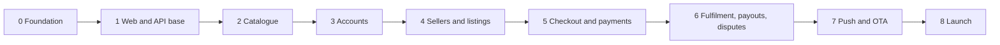

# Roadmap

The work is ordered so that each phase can be tested end to end before the next begins. A phase is finished when its exit criteria are met, not when its tasks are ticked off.

## Running alongside the phases

These depend on other people and take time, so start them during Phase 0 or 1:

- [ ] Get legal advice on holding seller funds ([why](DECISIONS.md#adr-011-hold-seller-money-until-delivery-then-release)). The answer is needed before Phase 6
- [ ] Register the business, and apply for a Paybill or Till number with Daraja access, including B2C
- [ ] Apply for a Paystack merchant account
- [ ] Settle the remaining [open items](DECISIONS.md#open-items) by the phase each one lists

## Phase 0: Foundation

**Goal:** A safe, current base.

- [x] Upgrade to Expo SDK 58.0.21 and install the required libraries
- [x] Make the product and architecture decisions, and write the documents
- [x] Rotate the exposed database password (confirmed by the owner on 2 November 2026)
- [x] Delete `Backend/`, which held the exposed credential
- [x] Review the Recommended items needed for Phases 1 and 2, the API and the data model
- [x] Commit the upgrade and documents
- [x] Build and install a development build on each platform

**Exit:** The old password no longer works, the upgrade is committed, and the app runs from a development build on a real device.

## Phase 1: Web and API base

**Goal:** A deployed Next.js app with a working database connection and a public website.

- [x] Scaffold `web/` with Next.js 16, TypeScript and the App Router
- [ ] Create the Atlas Free cluster, with separate dev and production databases and users
- [x] Create the Vercel project with root directory `web/`, and set the function region (`dub1`, Ireland)
- [x] Add `lib/db.ts`, `lib/http.ts`, `GET /api/v1/health` and `GET /api/v1/config`
- [ ] Test `attachDatabasePool` with Mongoose, and watch Atlas connection counts during a burst of requests
- [ ] Prove multi-document transactions work on Atlas Free, since the ledger depends on them
- [x] Build the full marketing page, plus draft privacy, terms, seller terms, support and delete-account pages
- [x] Add GitHub Actions for web and mobile checks, and a secret scan

**Exit:** `/api/v1/health` confirms database access from the production URL, the website is live, CI runs on pull requests, and a transaction test passes on Atlas.

## Phase 2: Catalogue

**Goal:** The app shows real products from the new API.

- [x] Add Seller and Product models, the public read endpoints, API tests and a seed script
- [x] Add `lib/api-client.ts`, `lib/media.ts` and TanStack Query, and point the app at `EXPO_PUBLIC_API_URL`
- [x] Rebuild Home and Categories on one shared product list, with filters, search and pagination
- [x] Switch to native tabs and native header controls
- [x] Rebuild product details without nested lists, showing the seller
- [x] Switch remote images to `expo-image` with Cloudinary sizes and placeholders
- [x] Replace `@react-native-picker/picker` with Expo UI's picker
- [x] Replace deprecated `@expo/vector-icons`
- [x] Apply the brand colours and Nunito, fix the `Colors` theme mismatch and remaining TypeScript errors, then make `tsc` a required CI check
- [x] Review screens on iOS 26+
- [ ] Check layout when an iPhone app is resized on iOS 27
- [ ] Run the catalogue flow on the Android phone
- [ ] Add real app screenshots to the marketing page, once they can show real product photos rather than Cloudinary's demo images

**Exit:** Live products display on both platforms with proper loading and error states, and `tsc` reports no errors.

## Phase 3: Accounts

**Goal:** People can sign in, stay signed in, and delete their account.

- [ ] Create Google OAuth clients, and replace the `iosUrlScheme` placeholder in `app.json`
- [ ] Install `expo-secure-store` and `expo-apple-authentication`, enable Sign in with Apple, and rebuild
- [ ] Add User and Session models and auth endpoints, with tests for rotation and reuse
- [ ] Add rate limiting to auth endpoints
- [ ] Build sign-in, required only for checkout, wish list, orders and selling
- [ ] Build the Profile screen: details, address, sign out, delete account
- [ ] Make `/delete-account` on the website functional

**Exit:** Google sign-in works on real iOS and Android devices, Apple sign-in works on iOS, expired sessions refresh silently, and deleted accounts lose access with their data removed.

## Phase 4: Sellers and listings

**Goal:** Approved sellers can list products with photos and short videos.

- [ ] Decide video limits and the microphone setting
- [ ] Create the Cloudinary account, check its terms, and set folders and upload rules
- [ ] Add `POST /uploads/sign` for images, video and private documents
- [ ] Build the seller application in the app
- [ ] Build the admin dashboard base: Google sign-in, role check, audit log
- [ ] Build seller review in the dashboard: documents, approve, reject, suspend
- [ ] Build listing management in the app with `expo-image-picker`: create, edit, archive
- [ ] Install `expo-video`, and add video playback with a poster on product details
- [ ] Add listing moderation and a way for users to report a listing

**Exit:** A new user can apply, get approved, and list a product with photos and video from a phone. Products from others cannot be edited, and the admin can remove a listing.

## Phase 5: Checkout and payments

**Goal:** A customer can buy from several sellers with M-Pesa or a card, in sandbox and test modes.

- [ ] Move the cart to Zustand and MMKV, grouped by seller
- [ ] Add Purchase, Order, LedgerEntry and WebhookEvent models
- [ ] Add `POST /checkout/quote` and `POST /checkout`, with server pricing, idempotency and stock reservation
- [ ] Integrate Daraja M-Pesa Express in the sandbox, after confirming its callback format and security
- [ ] Integrate Paystack in test mode, with the hosted page and verified webhooks
- [ ] Add the reservation expiry and payment reconciliation jobs
- [ ] Build checkout with delivery details, per-seller fees and payment choice
- [ ] Build the real Wish List tab, and remove the mock payment screen and its logos
- [ ] Remove `@reduxjs/toolkit`, `react-redux`, `redux`, `redux-persist`, `axios` and AsyncStorage

**Exit:** A multi-seller purchase works with both payment methods in test modes. Tests prove clients cannot set prices, duplicate webhooks have no effect, and the ledger matches every payment. No Redux code remains.

## Phase 6: Fulfilment, payouts and disputes

**Goal:** Money reaches sellers only after delivery, and problems can be resolved.

**Do not start until the [legal review](DECISIONS.md#open-items) is back.** It could change this design.

- [ ] Decide the commission rate, release days, dispute window and returns policy
- [ ] Decide how card-funded payouts are funded
- [ ] Build seller order screens: accept, reject, dispatch, mark delivered
- [ ] Build buyer order screens: timeline, confirm delivery, cancel
- [ ] Add the release job
- [ ] Add Payout model and job with Daraja B2C in the sandbox, with idempotent retries
- [ ] Add refunds for M-Pesa and cards
- [ ] Build disputes in the app, and the case screen in the dashboard
- [ ] Build seller earnings and statements in the app
- [ ] Build payout oversight and a reconciliation view in the dashboard

**Exit:** In test modes, orders complete by confirmation and by timeout, payouts arrive once only, a dispute freezes and redirects the money correctly, and the ledger reconciles to provider records.

## Phase 7: Push and OTA

**Goal:** People hear about their orders, and small fixes can ship without store review.

- [ ] Create the Firebase project, and upload FCM V1 credentials to EAS
- [ ] Generate an APNs key through EAS
- [ ] Register push tokens after sign-in, with the Android channel created first
- [ ] Send pushes for order, dispute, application and payout events, opening the right screen when tapped
- [ ] Add the receipt job
- [ ] Publish a test update to `preview`, and confirm a preview build applies it

**Exit:** Events reach real iOS and Android devices, dead tokens are removed, and an OTA update has been seen working end to end.

## Phase 8: Launch

**Goal:** The marketplace is live in both stores, with real money.

- [ ] **Move Vercel to Pro**, and set production cron schedules
- [ ] Switch to live Daraja and Paystack keys, and test with small real payments, payouts and refunds
- [ ] Buy the domain, and finalise privacy policy, terms and seller terms with legal review
- [ ] Decide the Atlas tier, and enable backups and alerts
- [ ] Add error reporting and alerts for failed payouts and webhooks
- [ ] Onboard the first sellers
- [ ] Run the [release checklist](DEPLOYMENT.md#release-checklist)
- [ ] Prepare store listings, screenshots, Play Data Safety and Apple App Privacy answers
- [ ] Release to TestFlight and Play internal testing, then production

**Exit:** The app is approved in both stores, and a real order has gone from payment through delivery to a seller payout.

## After launch

Ideas, in no particular order: per-size stock, reviews, discount codes, promoted listings, a courier partnership, a web dashboard for sellers, and shared API types.
