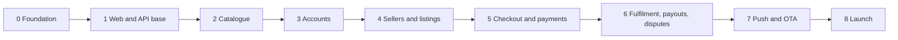

# Roadmap

The work is ordered so that each phase can be tested end to end before the next begins. A phase is finished when its exit criteria are met, not when its tasks are ticked off.

## Running alongside the phases

These depend on other people and take time, so start them during Phase 0 or 1:

- [ ] Get legal advice on holding seller funds ([why](DECISIONS.md#adr-011-hold-seller-money-until-delivery-then-release)). The answer is needed before Phase 6
- [ ] Register the business, and apply for a Paybill or Till number with Daraja access, including B2C
- [ ] Apply for a Paystack merchant account
- [ ] Settle the remaining [open items](DECISIONS.md#open-items) by the phase each one lists

## Phase 0: Foundation

**Goal:** A safe, current base.

- [x] Upgrade to Expo SDK 58.0.21 and install the required libraries
- [x] Make the product and architecture decisions, and write the documents
- [x] Rotate the exposed database password (confirmed by the owner on 2 November 2026)
- [x] Delete `Backend/`, which held the exposed credential
- [x] Review the Recommended items needed for Phases 1 and 2, the API and the data model
- [x] Commit the upgrade and documents
- [x] Build and install a development build on each platform

**Exit:** The old password no longer works, the upgrade is committed, and the app runs from a development build on a real device.

## Phase 1: Web and API base

**Goal:** A deployed Next.js app with a working database connection and a public website.

- [x] Scaffold `web/` with Next.js 16, TypeScript and the App Router
- [x] Create the Atlas Free cluster, with separate dev and production databases and users
- [x] Create the Vercel project with root directory `web/`, and set the function region (`dub1`, Ireland)
- [x] Add `lib/db.ts`, `lib/http.ts`, `GET /api/v1/health` and `GET /api/v1/config`
- [x] Test `attachDatabasePool` with Mongoose, and watch Atlas connection counts during a burst of requests (peak 92 of 500, across 700 requests at 30 concurrent)
- [x] Prove multi-document transactions work on Atlas Free, since the ledger depends on them
- [x] Build the full marketing page, plus draft privacy, terms, seller terms, support and delete-account pages
- [x] Add GitHub Actions for web and mobile checks, and a secret scan

**Exit:** `/api/v1/health` confirms database access from the production URL, the website is live, CI runs on pull requests, and a transaction test passes on Atlas.

## Phase 2: Catalogue

**Goal:** The app shows real products from the new API.

- [x] Add Seller and Product models, the public read endpoints, API tests and a seed script
- [x] Add `lib/api-client.ts`, `lib/media.ts` and TanStack Query, and point the app at `EXPO_PUBLIC_API_URL`
- [x] Rebuild Home and Categories on one shared product list, with filters, search and pagination
- [x] Switch to native tabs and native header controls
- [x] Rebuild product details without nested lists, showing the seller
- [x] Switch remote images to `expo-image` with Cloudinary sizes and placeholders
- [x] Replace `@react-native-picker/picker` with Expo UI's picker
- [x] Replace deprecated `@expo/vector-icons`
- [x] Apply the brand colours and Nunito, fix the `Colors` theme mismatch and remaining TypeScript errors, then make `tsc` a required CI check
- [x] Review screens on iOS 26+
- [x] Make layouts adapt to any window size and orientation, checked on two iPhones in both orientations, an iPad and the iPhone Duo ([ADR-035](DECISIONS.md#adr-035-adapt-to-any-window-size-with-no-orientation-lock))
- [ ] Run the catalogue flow on the Android phone
- [ ] Add real app screenshots to the marketing page, once real listings exist. The sample catalogue uses Cloudinary's sample photos

**Exit:** Live products display on both platforms with proper loading and error states, and `tsc` reports no errors.

## Phase 3: Accounts

**Goal:** People can sign in, stay signed in, and delete their account.

- [x] Create Google OAuth clients, set `GOOGLE_WEB_CLIENT_ID` and the app's client IDs, and replace the `iosUrlScheme` placeholder in `app.json` (3 November 2026)
- [ ] Add the SHA-1 of the debug key and the EAS signing key to the Android OAuth client, and the two `EXPO_PUBLIC_GOOGLE_*` values to EAS
- [x] Install `expo-secure-store` and `expo-apple-authentication`, and turn on `usesAppleSignIn`
- [ ] Enable Sign in with Apple for `com.hautecorner.app` in the Apple Developer account
- [x] Add User and Session models and auth endpoints, with tests for rotation and reuse
- [x] Set `JWT_SECRET` and `APPLE_BUNDLE_ID` locally and in both Vercel environments
- [x] Add rate limiting to auth endpoints ([ADR-039](DECISIONS.md#adr-039-rate-limiting-with-counters-in-mongodb))
- [x] Add email sign-up with emailed codes, welcome emails and password reset, sent through Gmail ([ADR-036](DECISIONS.md#adr-036-email-sign-up-with-emailed-codes-alongside-google-and-apple))
- [x] Link accounts that share a verified email ([ADR-037](DECISIONS.md#adr-037-one-account-per-verified-email))
- [x] Build sign-in, required only for checkout, orders and selling
- [x] Build the Profile screen: details, address, sign-in methods, password, sign out, delete account
- [x] Build the Wish List: likes kept on the device, and synced to the account once signed in ([ADR-038](DECISIONS.md#adr-038-likes-without-an-account-synced-once-signed-in))
- [x] Show skeletons while screens load ([ADR-040](DECISIONS.md#adr-040-skeletons-while-loading))
- [ ] Revoke Sign in with Apple tokens when an account is deleted
- [ ] Make `/delete-account` on the website functional
- [ ] Run the sign-in, email and wish list flows on the Android phone

**Exit:** Google sign-in works on real iOS and Android devices, Apple sign-in works on iOS, email sign-up and password reset work, expired sessions refresh silently, and deleted accounts lose access with their data removed.

## Phase 4: Sellers and listings

**Goal:** Approved sellers can list products with photos and short videos.

- [x] Decide video limits and the microphone setting: 30 seconds and 100 MB, from the library only (13 November 2026, [ADR-042](DECISIONS.md#adr-042-product-videos-one-per-listing-up-to-30-seconds-and-100-mb), [ADR-043](DECISIONS.md#adr-043-videos-come-from-the-library-no-microphone-permission))
- [x] Create the Cloudinary account (cloud `dxnevfcm`, 3 November 2026)
- [x] Set folders and upload rules: signed by the API, which chooses each file's folder and name
- [ ] Check Cloudinary's terms, and add `CLOUDINARY_URL` to Vercel Preview
- [x] Add `POST /uploads/sign` for images, video and private documents, tested against the real Cloudinary account
- [x] Build the seller application in the app, in the Sell tab
- [x] Build the admin dashboard base: Google sign-in, role check, audit log
- [ ] Add the site's addresses to the web OAuth client's Authorized JavaScript origins, and give your account the admin role ([how](SETUP.md#admin-dashboard-phase-4))
- [x] Build seller review in the dashboard: documents, approve, reject, suspend
- [x] Build listing management in the app with `expo-image-picker`: create, edit, archive
- [x] Install `expo-video`, and add video playback with a poster on product details
- [x] Add listing moderation and a way for users to report a listing
- [x] Check apply, approve, list with photo and video, and report on two iOS simulators (13 November 2026)
- [ ] Run the seller flows on the Android phone

**Exit:** A new user can apply, get approved, and list a product with photos and video from a phone. Products from others cannot be edited, and the admin can remove a listing.

## Phase 5: Checkout and payments

**Goal:** A customer can buy from several sellers with M-Pesa or a card, in sandbox and test modes.

- [x] Move the cart to Zustand and MMKV, grouped by seller
- [x] Add Purchase, Order, LedgerEntry and WebhookEvent models
- [x] Add `POST /checkout/quote` and `POST /checkout`, with server pricing, idempotency and stock reservation
- [x] Build Daraja M-Pesa Express, with callbacks confirmed by a status query ([R-32](DECISIONS.md#recommended))
- [ ] Try it in the Daraja sandbox, once you have sandbox keys ([how](SETUP.md#safaricom-daraja-phase-5))
- [x] Build Paystack cards, with the hosted page and verified webhooks
- [ ] Try it in Paystack test mode, once you have a test key ([how](SETUP.md#paystack-phase-5))
- [x] Add the reservation expiry and payment reconciliation jobs (scheduled once on Vercel Pro)
- [x] Build checkout with delivery details, per-seller fees and payment choice, and a My Orders screen in place of Track Order
- [x] Check a two-seller M-Pesa checkout, with simulated payments, on two iOS simulators (13 November 2026)
- [ ] Run checkout on the Android phone
- [x] Build the real Wish List tab, and remove the mock payment screen and its logos (done early, in Phase 3)
- [x] Remove `@reduxjs/toolkit`, `react-redux`, `redux`, `redux-persist`, `axios` and AsyncStorage
- [ ] Before deploying this to production, set the SES variables in Vercel and run `sync-indexes` on the production database, which has `autoIndex` off ([how](SETUP.md#running-a-script-against-production))

**Exit:** A multi-seller purchase works with both payment methods in test modes. Tests prove clients cannot set prices, duplicate webhooks have no effect, and the ledger matches every payment. No Redux code remains.

## Phase 6: Fulfilment, payouts and disputes

**Goal:** Money reaches sellers only after delivery, and problems can be resolved.

**Do not start until the [legal review](DECISIONS.md#open-items) is back.** It could change this design.

- [ ] Decide the commission rate, release days, dispute window and returns policy
- [ ] Decide how card-funded payouts are funded
- [ ] Build seller order screens: accept, reject, dispatch, mark delivered
- [ ] Build buyer order screens: timeline, confirm delivery, cancel
- [ ] Add the release job
- [ ] Add Payout model and job with Daraja B2C in the sandbox, with idempotent retries
- [ ] Add refunds for M-Pesa and cards
- [ ] Build disputes in the app, and the case screen in the dashboard
- [ ] Build seller earnings and statements in the app
- [ ] Build payout oversight and a reconciliation view in the dashboard

**Exit:** In test modes, orders complete by confirmation and by timeout, payouts arrive once only, a dispute freezes and redirects the money correctly, and the ledger reconciles to provider records.

## Phase 7: Push and OTA

**Goal:** People hear about their orders, and small fixes can ship without store review.

- [ ] Create the Firebase project, and upload FCM V1 credentials to EAS
- [ ] Generate an APNs key through EAS
- [ ] Register push tokens after sign-in, with the Android channel created first
- [ ] Send pushes for order, dispute, application and payout events, opening the right screen when tapped
- [ ] Add the receipt job
- [ ] Publish a test update to `preview`, and confirm a preview build applies it

**Exit:** Events reach real iOS and Android devices, dead tokens are removed, and an OTA update has been seen working end to end.

## Phase 8: Launch

**Goal:** The marketplace is live in both stores, with real money.

- [ ] **Move Vercel to Pro**, and set production cron schedules
- [ ] Switch to live Daraja and Paystack keys, and test with small real payments, payouts and refunds
- [ ] Buy the domain, and finalise privacy policy, terms and seller terms with legal review
- [ ] Decide the Atlas tier, and enable backups and alerts
- [ ] Add error reporting and alerts for failed payouts and webhooks
- [ ] Remove the sample catalogue from production with `remove-samples`
- [ ] Onboard the first sellers
- [ ] Run the [release checklist](DEPLOYMENT.md#release-checklist)
- [ ] Prepare store listings, screenshots, Play Data Safety and Apple App Privacy answers
- [ ] Declare trader status in Play Console, and fill in the trader address and phone in `web/lib/site.ts` to match ([ADR-044](DECISIONS.md#adr-044-realhive-consultants-is-the-trader))
- [x] Move email from Gmail to Amazon SES, and test it (done early, 13 November 2026, [ADR-041](DECISIONS.md#adr-041-all-email-through-amazon-ses))
- [ ] Set `EMAIL_TRANSPORT=ses`, `SES_REGION` and the `AWS_SES_*` keys in both Vercel environments
- [ ] Release to TestFlight and Play internal testing, then production

**Exit:** The app is approved in both stores, and a real order has gone from payment through delivery to a seller payout.

## After launch

Ideas, in no particular order: per-size stock, reviews, discount codes, promoted listings, a courier partnership, a web dashboard for sellers, and shared API types.
